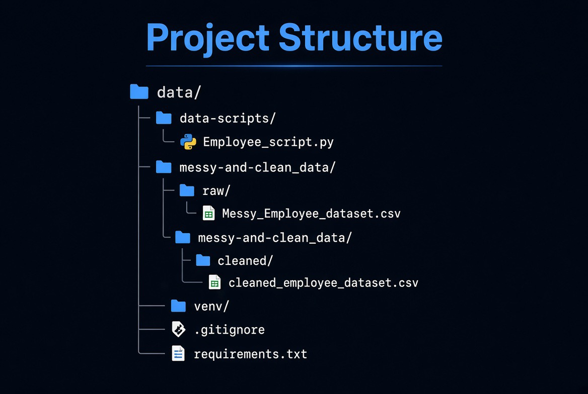

# HR Data Clearing and Processing Pipeline


A practical data cleaning project using a messy employee dataset.  
The goal was to take raw, inconsistent HR-style data and turn it into a clean, analysis-ready dataset.

---

## Project Overview

This project demonstrates common real-world data cleaning tasks, including:

- Handling missing values
- Fixing inconsistent data types
- Removing duplicates
- Splitting compound columns
- Standardizing text and column names
- Preparing data for analysis or machine learning

The original dataset contained typical messy data problems such as inconsistent date formats, non-numeric salary values, missing ages, and a combined Department-Region column.

---

## Project Structure




---

## How to Run

1. Clone the repository
2. Create and activate a virtual environment:

```bash
python -m venv venv
# For Windows
venv\Scripts\activate
# For Mac/Linux
source venv/bin/activate

Install Python dependencies
• pip install -r requirements.txt

Run the clearing script
• python Employee_script.py

The cleaned file will be saved in: messy-and-clean_data/cleaned/cleaned_employee_dataset.csv

——-

Cleaning Steps Performed
•  Standardized column names
•  Removed duplicate rows
•  Converted Join_Date to proper datetime format
•  Converted Salary and Age to numeric values
•  Handled missing values (filled numeric columns with median)
•  Split Department_Region into separate Department and Region columns
•  Cleaned and standardized text values

Tools Used
•  Python
•  Pandas
•  NumPy

## Author
Michael Ifeanyi Ibeh
